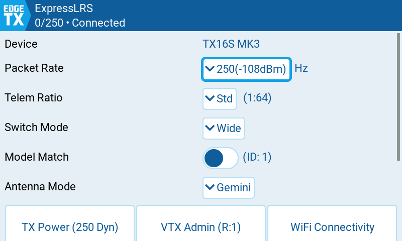
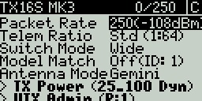
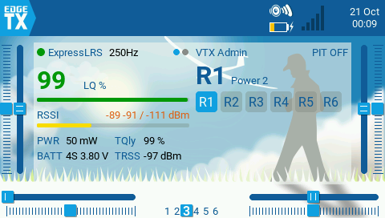
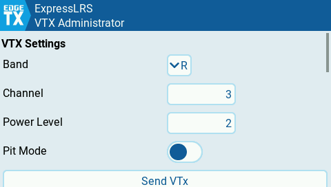
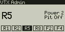
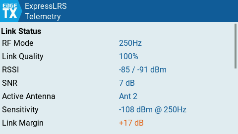
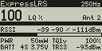
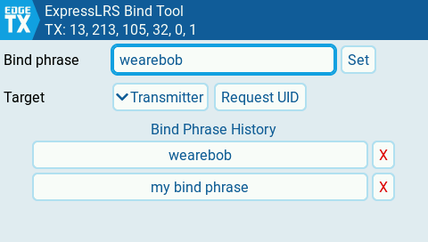
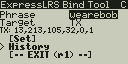

# Meet the New ExpressLRS Lua Scripts

The ExpressLRS Lua script has had a major overhaul. It loads faster, colour radios get a new touch user interface, and it now comes with three new tools: a VTX Admin widget for quick channel changes at race events, a telemetry widget for your home screen, and a Bind Phrase Manager.

<!-- more -->

## A new home and updated priorities

Since its inception, the Lua script was a single `elrs.lua` file with a design focus on memory optimization and a single-file install. These priorities meant there was rarely a reason to upgrade, as very little functionality was added over the years: there just wasn't space for it. The scripts now live in [ExpressLRS/Lua](https://github.com/ExpressLRS/Lua) and are designed for rich and expanding functionality, which can be released as needed without waiting for the next ExpressLRS firmware version.

Every [release](https://github.com/ExpressLRS/Lua/releases) is a single zip that you extract onto your SD card, and it contains all of the tools and widgets below.

## What's in the package

### ExpressLRS Configuration Tool

The `ExpressLRS` tool configures your transmitter module and receiver, just like `elrs.lua` did. On colour radios it now has a new touch user interface built from native EdgeTX controls, so it looks and behaves like the rest of your radio. Black & white radios keep the classic text layout. It also loads faster, so you spend less time looking at `Loading...` when you open the tool or a folder.

{ width="480" }

{ width="384" style="image-rendering: pixelated" }

### VTX Admin widget and screen

The `ExpressLRS VTX Admin` widget was built with racing in mind, but it is just as handy whenever you share the air with other pilots, such as a freestyle session with friends. At a race, the race director hands out video channels heat by heat, and digging through the Lua menus to change yours adds extra steps and extra stress right before you fly.

Set it up once before the event: program each band and channel you'll need into a preset, one for each of the six 6POS buttons on your radio. When your heat is called, press the matching button and your VTX changes channel, along with your goggles if they have a [VRX Backpack](../../hardware/backpack/esp-backpack.md).

You can keep up to six sets of six presets, for example one per race series or regular flying spot, and swap between them in the settings.

The widget also shows the current band, channel, power and pit mode at a glance, and a long press opens its full-screen settings.

Black & white radios get the same features as a telemetry screen: in **Model Setup > Telemetry**, pick the `ELRVTX` script for one of the screens. It shows the current band, channel, power, pit mode and 6POS presets. Press ++enter++ for the settings.

{ width="384" style="image-rendering: pixelated" }

### Telemetry widget and screen

The `ExpressLRS Telemetry` widget shows live link statistics on your home screen. Bigger widget zones show more detail, and a long press opens a full-screen list of every telemetry item.

On black & white radios, pick the `ELRTLM` script for a telemetry screen. It shows link quality, RSSI, RF mode, power and battery at a glance. Press ++enter++ for the full list.

{ width="384" style="image-rendering: pixelated" }

### ExpressLRS Bind Phrase Manager

The `ExpressLRS Bind` tool lets you set the binding phrase on your transmitter or receiver directly from the radio. If you share models by swapping binding phrases, you can now do it from the handset without going through WiFi. Instead of a phrase you can also type a UID as 4 to 6 comma-separated numbers, or read back the UID a device is using. The tool keeps a history of phrases you have used, so switching back to one is quick. It works on both colour and B&W screens.

{ width="384" style="image-rendering: pixelated" }

!!! note "ExpressLRS 4.1"
    Setting the binding phrase from the radio requires ExpressLRS 4.1 or newer on the device you are changing.

## Compatibility

| Radio | EdgeTX | ExpressLRS | Download |
|-------|--------|------------|----------|
| Colour or B&W screen | 2.12.1+ or 3.0+ | 3.5.4+ | `expresslrs-lua-vX.Y.Z.zip` |
| Older EdgeTX, OpenTX or low-RAM radios | any | any | `expresslrs-lua-legacy.zip` |

The Bind Phrase Manager additionally needs ExpressLRS 4.1+ to set a binding phrase. The widgets need a colour screen; B&W radios use the telemetry screens instead.

## Installing or upgrading

1. Download `expresslrs-lua-vX.Y.Z.zip` from the [latest release](https://github.com/ExpressLRS/Lua/releases/latest).
2. Delete any old ELRS scripts from `SCRIPTS/TOOLS/` on your SD card: `elrs.lua`, `elrsV2.lua`, `elrsV3.lua` and their `.luac` counterparts.
3. Extract the zip onto the **root** of your SD card, keeping the folder structure and overwriting existing files.
4. Open the Tools menu on your radio. You will find **ExpressLRS** and **ExpressLRS Bind** there.
5. Optional: add the **ExpressLRS VTX Admin** or **ExpressLRS Telemetry** widget to a home screen, or on a B&W radio pick `ELRVTX` or `ELRTLM` as a telemetry screen.

## Older radios: the legacy script

If your radio can't run EdgeTX 2.12.1, runs OpenTX, or doesn't have enough RAM for the new scripts, the original single-file `elrs.lua` is still available. Every release also includes `expresslrs-lua-legacy.zip`; extract it onto your SD card root and use it as before.

## Feedback and nightly builds

Found a bug, or have an idea? Open an issue on [ExpressLRS/Lua](https://github.com/ExpressLRS/Lua/issues). Please include your radio model, your EdgeTX version and your ExpressLRS firmware version.

If you want the latest changes before they are released, a [nightly build](https://github.com/ExpressLRS/Lua/releases/tag/nightly) is published from the main branch. Nightly builds are development builds and may contain bugs.

## Special thanks

- [CapnBry](https://github.com/CapnBry) for the years of work on the original `elrs.lua`, developing the Bind Phrase Manager, and a sharp eye on bugs, extensive testing and support throughout development.
- [wimalopaan](https://github.com/wimalopaan) for all the testing, the edge cases found and the feature requests.
