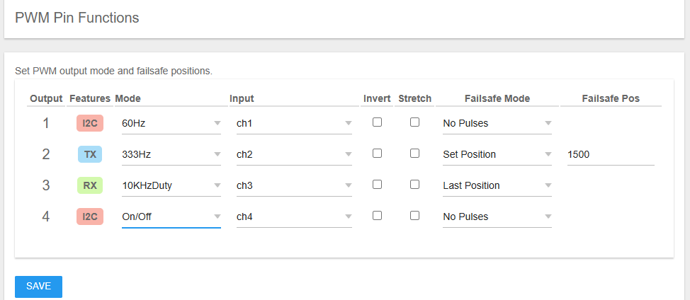
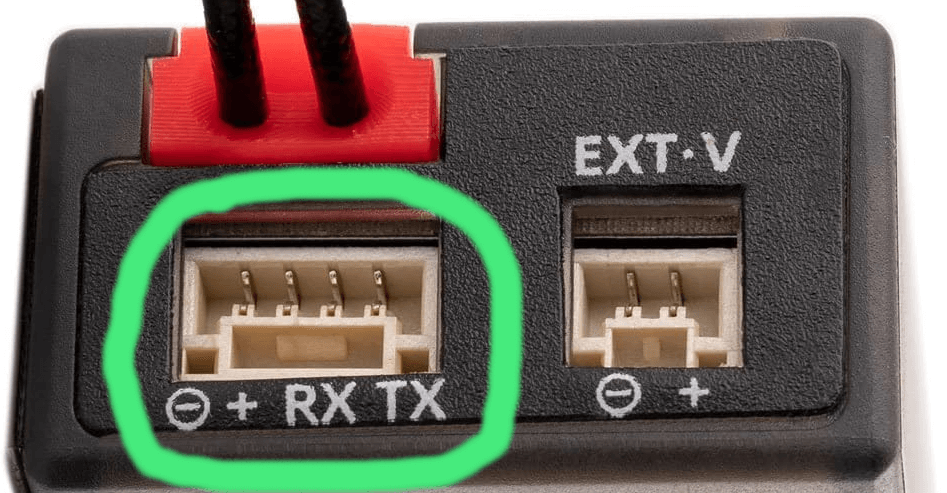

ExpressLRS now supports direct PWM output from receivers. This documentation refers to only receivers with native PWM output, not receivers attached to external CRSF to PWM converters such as the [CRServoF](https://github.com/CapnBry/CRServoF/) or [Matek CRSF-PWM-C](http://www.mateksys.com/?portfolio=crsf-pwm).

## Channel Mapping and Failsafe
The default channel mapping is straight through: CH1 from the TX goes to PWM Output 1, CH2 to Output 2, etc. To change this on ESP-based receivers, allow the receiver to go into WiFi mode then use the WebUI to configure the mapping. Any input channel can be mapped to any output channel, and the same input can be used for as many outputs as desired. 

<figure markdown>

<figcaption>PWM Output WebUI</figcaption>
</figure>

Failsafe values are set using this UI as well, with values that can range from 988-2012us. When Stretch is enabled for an output, the failsafe range extends to 476-2523us. Enter the pulse width you want the servo to receive during failsafe; it is used as entered and is not stretched again. The Lua `Set Failsafe Pos` command saves the current output position, including any stretch and inversion.

Failsafe is entered if the receiver is connected and Link Quality (LQ) drops to 0, or 1 second has passed without a valid channels packet being received, whichever comes first.

On startup, no pulses are generated until a transmitter connects, allowing ESC throttle calibration with the standard "raise the throttle before connecting" method. The default failsafe value is 1500us for all channels except Output 3, which defaults to 988us.

## Channel Resolution
With ExpressLRS v3.0's introduction of Full Resolution Modes (e.g. 100Hz Full and 333Hz Full), PWM Receivers now have access to full 10-bit resolution on all PWM output channels. Prior to this, PWM output is subject to the resolution of the ELRS protocol, which means by default there are still only 4x full resolution channels (10-bit CH1-CH4) and 8x switch channels (CH5-CH12). See the table in [Switch Configs](https://www.expresslrs.org/software/switch-config/) for more information and breakdown of these modes.

ExpressLRS 4.0 also introduced an alternative arming method that takes away the necessity of remapping outputs to skip Channel Input 5 that is used for arming. See [Alternate Arming](https://www.expresslrs.org/quick-start/transmitters/tx-prep/#version-40-arming-options).

!!! hint "Stretch and resolution"
	In the full-resolution switch modes, the stretch is applied from the full-resolution channel limits rather than the standard limits, which increases the precision of the output by about 50%. Stretching does not change the PWM frequency or update rate.

## Supported Output Modes
ELRS receivers support the following PWM output modes:

* PWM output frequencies: 50Hz, 60Hz, 100Hz, 160Hz, 333Hz, 400Hz
* Normal pulse width (988-2012us, center 1500us)
* Extended pulse width (880-2120us, center 1500us)
* Stretched pulse width (500-2500us, center 1500us), for servos that need a wider pulse range to reach full travel
* 10kHz Duty Cycle 0-100% PWM (e.g. for driving a brushed motor FET)

On top of this, outputs can also be set to:

* Binary On/Off (High/Low signal output)
* DSHOT300 (for driving brushless motor ESCs; ESP32-based receivers only)

!!! note "Half pulse width (750us) mode removed"
	Earlier versions included a "half pulse width" (narrow) option with a 494-1006us range centered on 750us. It was replaced by the Stretch option in ExpressLRS 4.0, and the old setting is not migrated automatically, so recheck your outputs after updating. To get the same result, see [Replicating the old 750us mode](#replicating-the-old-750us-half-pulse-width-mode).

## Servos That Need Non-Standard Pulse Widths

### Stretch mode (500-2500us)

Some servos need pulses of roughly 500-2500us to reach their full range of motion. Instead of buying an external "servo stretcher", check the Stretch option for the channel. With Stretch enabled, a normal 1000-2000us-equivalent input produces a 500-2500us output pulse.

Stretch is useful for servos that must travel up to 180° or 270°, as well as for steering and drag-racing setups where users want more travel than a standard range provides. Intermediate scales (e.g. 150%) are not offered. If you need less than the full stretch, reduce the travel in your transmitter with end points or weights.

### Replicating the old 750us (half pulse width) mode

The old half pulse width mode produced roughly 500-1000us pulses centered on 750us. You can get the same output with Stretch mode plus output limits and subtrim in your transmitter. In Stretch mode, 500us is at the bottom of the channel range and 1000us is one quarter of the way up, so the channel needs to cover about -100% to -50%, centered on -75%.

In EdgeTX, on the **Outputs** page for the channel:

| Setting | Value |
|---|---|
| Subtrim (center) | -75% |
| Min | -99% |
| Max | -50% |

Alternatively, on the channel's mixer line set **Weight 24%** and **Offset -75%**.

!!! note
	Min is set slightly above -100% to stay clear of exactly 500us. Only a quarter of the stretched range is used, so resolution is lower than a native 500-1000us output. Check the result with a servo tester or oscilloscope and adjust to suit your servo.

For failsafe, enter the pulse width directly in the WebUI (e.g. 750us).

## Serial Output
PWM receivers can also output any supported [serial protocol](https://www.expresslrs.org/software/serial-protocols/), such as CRSF or SBUS. [Select the desired output protocol](https://www.expresslrs.org/software/serial-protocols/#receiver-protocol-selection) using the ELRS lua, or on the Model tab in the receiver's WebUI. 
The default pins used for serial output vary by receiver. If your receiver has a dedicated serial port (e.g. RadioMaster ER6, ER8, ER8G(V)), serial output will be over this port. Otherwise, [check the Model tab](https://www.expresslrs.org/software/serial-protocols/#pwm-receiver-serial-pin-selection) in the receiver's WebUI to see which pins can be mapped to Serial TX and RX (usually Ch2 and Ch3). 

<figure markdown>

<figcaption>JST-GH Serial Port on RadioMaster ER6 PWM Receiver</figcaption>
</figure>

!!! warning "Advanced Output Mapping"
	Advanced users can remap serial, I2C, and PWM outputs to any available pin using the hardware.html page in the receiver's WebUI. Please ask on the [ELRS Discord](https://discord.gg/dS6ReFY) if you need help configuring non-standard receiver output mapping. 
