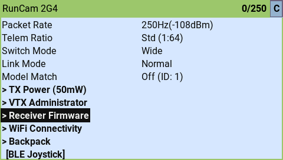
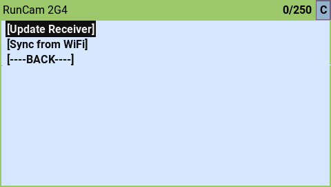
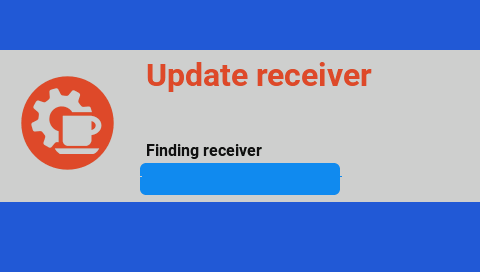
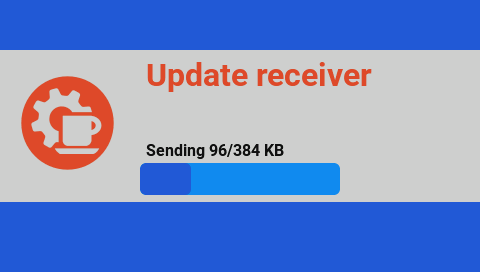
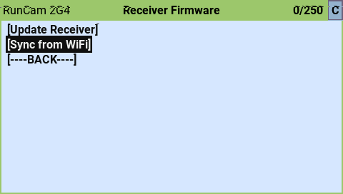
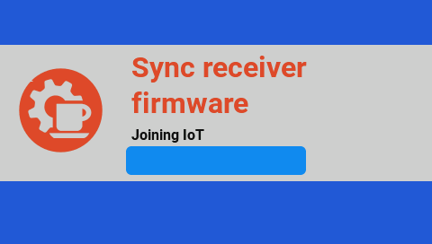
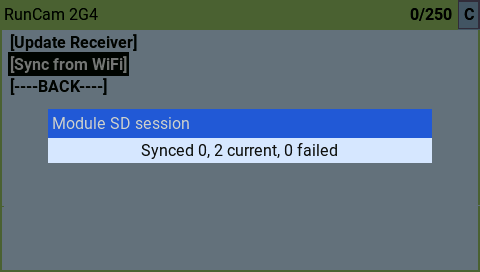

!!! warning "Not released yet"
    This feature is in test builds only. It needs a special build of **EdgeTX**, a special build of **ExpressLRS** on the TX module, and the same build on the receiver. None of it is in a release.

    * EdgeTX: [MUSTARDTIGERFPV/edgetx, branch `elrs-oh-tee-eh`](https://github.com/MUSTARDTIGERFPV/edgetx/tree/elrs-oh-tee-eh)
    * ExpressLRS: [mustardtigerfpv/expresslrs, branch `elrs-oh-tee-eh`](https://github.com/mustardtigerfpv/expresslrs/tree/elrs-oh-tee-eh)

    Menu names, file names and messages on this page can still change before a release.

Your radio's SD card can hold receiver firmware, and your TX module can push it to a bound receiver over the air. You don't need a cable, a flight controller passthrough or the receiver's WiFi hotspot. The receiver keeps its binding, settings and hardware layout.

There are two actions, both in the ExpressLRS Lua script under `Receiver Firmware`:

* `Sync from WiFi` joins your WiFi from the TX module, downloads receiver firmware and stores it on the radio's SD card. Nothing on the receiver changes. The menu shows the network it will use, for example `Sync from WiFi (HomeNet)`.
* `Update Receiver` takes the matching firmware from the SD card and sends it to the receiver. It takes about 10 to 20 seconds. A connected receiver is updated right away; one that isn't connected is updated when you power it on (see [Updating a receiver that won't connect](#updating-a-receiver-that-wont-connect)).

You can skip `Sync from WiFi` and copy the firmware onto the card yourself. See [Getting the images](#getting-the-images).

## What you need

* **The current `elrs.lua` script** from the ExpressLRS repository, in `/SCRIPTS/TOOLS/` on the radio. Delete old copies such as `ELRS.lua`, `elrsV2.lua` and `elrsV3.lua`. See [the Lua script guide](../quick-start/transmitters/lua-howto.md#installing-the-lua-script).
* **EdgeTX** radio running the build linked above. It was developed on a RadioMaster TX16S MK1 (480x272 color screen). Radios with other screens use a simpler popup. That hasn't been tested.
* **TX module** with an ESP32-family chip (ESP32, ESP32-S3 or ESP32-C3), running the ExpressLRS build linked above. It was developed on an ESP32-S3 module. ESP8285 and STM32 TX modules don't have the feature.
* **Receiver** with an ESP32-family chip or an ESP8285, running the same ExpressLRS build. STM32 receivers are not supported.
* **A binding phrase** set on both the TX module and the receiver, and the same on both. The TX module works out the receiver's address from it. Receivers bound with the Bind button are not covered.
* **The receiver** either connected to your TX module (the `C` on the Lua script's title bar), or within reach so you can power it on during the update. Either way **disarmed**.
* **An SD card** in the radio. While the radio is in USB storage mode it won't offer the card to the TX module.
* **WiFi** on the 2.4 GHz band, but only if you use `Sync from WiFi`.

!!! note "The first install is the old way"
    The receiver has to already be running firmware that includes this feature. Flash it once with the Configurator, WiFi or passthrough as usual. After that, updates can come from the SD card.

## Prepare the SD card

Everything lives in an `ELRS` folder at the top level of the card. The radio only lets the TX module touch this folder and nothing else on the card, so your models and settings are safe.

```
/ELRS/
    WIFI.TXT
    FIRMWARE/
        manifest.json
        esp32-2400/
            4.1.0.bin.gz
        esp8285-2400/
            4.1.0.bin.gz
```

You create `/ELRS/` and `WIFI.TXT` yourself. The radio creates `/ELRS/` when the first session starts. `FIRMWARE/` and everything under it is created by `Sync from WiFi`, or by you if you copy images by hand.

### WIFI.TXT

You only need this file for `Sync from WiFi`. Plain text, one value per line:

```
MyHomeWiFi
my-wifi-password
http://192.168.1.50:8088/manifest.json
```

1. Line 1: the WiFi network name.
2. Line 2: the password.
3. Line 3 (optional): the URL of the manifest, see below.

Notes:

* The file must stay under 255 bytes.
* Blank lines are skipped, so the network needs a password. Open networks don't work with this file.
* The URL has to start with `http://`. `https://` is not supported.
* Without line 3, the TX module uses the URL from the last sync that finished with no failures. If there is none, you get `no manifest URL set`.
* Without `WIFI.TXT`, the TX module falls back to the home WiFi name and password flashed into its own firmware options.

## Getting the images

### Option 1: Sync from WiFi

The TX module downloads a **manifest**, a small JSON file that lists the images. Then it downloads each image in the list, checks its SHA-256 and saves it on the card. Images that are already on the card with the right size are skipped.

!!! info "Not decided yet: where the manifest lives"
    There is no official manifest or download host yet. Until there is, you need to host the manifest and the images yourself, on a PC or a NAS that your WiFi can reach. Any web server works, including `python -m http.server`.

A manifest looks like this:

```json
{
 "release": "4.1.0",
 "images": {
  "esp32-2400": {
   "version": "4.1.0",
   "file": "esp32-2400/4.1.0.bin.gz",
   "size": 797533,
   "sha256": "98fd5b4ab01b1185e731180055567c1d532bde80f2ce92ac17ffabc1b3a0c793"
  },
  "esp8285-2400": {
   "version": "4.1.0",
   "file": "esp8285-2400/4.1.0.bin.gz",
   "size": 393246,
   "sha256": "a3fd277c8705baeb09fd34ad6b13779197c18f99ee9ce84ad8a08d68d6cf2005"
  }
 }
}
```

* Each name under `images` is an [image key](#which-image-goes-to-which-receiver). Only list the keys you need.
* `file` is a path relative to the manifest's own URL, or a full `http://` URL.
* `size` is the size in bytes of the file as downloaded. `sha256` is its SHA-256 as 64 hex characters.
* `version` and the key may only use letters, digits, `.`, `_` and `-`, up to 24 characters. An entry that breaks this is counted as failed.

On the card, an image is stored as `/ELRS/FIRMWARE/<key>/<version>.bin.gz`. A copy of the manifest is saved as `/ELRS/FIRMWARE/manifest.json` when every image arrived. Download problems never leave a half-written image under its real name. A download in progress is called `<version>.bin.gz.part` and gets deleted if it fails.

Sync never deletes old versions. See [which image gets used](#which-image-goes-to-which-receiver) before you let several versions pile up.

### Option 2: copy the images yourself

Put the radio in USB storage mode, or take the card out and use a card reader, and copy the files into `/ELRS/FIRMWARE/<key>/`:

* **ESP8285 receivers** need a `.bin.gz` file.
* **ESP32-family receivers** accept a `.bin` or a `.bin.gz` file. The TX module unpacks `.gz` files itself.

The file can have any name as long as it ends in `.bin` or `.bin.gz` and the folder name is the exact image key. Eject the card properly and put the radio back in normal mode before you run an update.

### Which image goes to which receiver

When you run `Update Receiver`, the receiver tells the TX module its image key. The TX module looks in `/ELRS/FIRMWARE/<key>/` and takes **the last file in alphabetical order**. The sort is by text, not by version number, so `4.9.0` sorts after `4.10.0`. Keep one image per folder and the question goes away.

| Receiver | Image key |
| --- | --- |
| ESP32 2.4 GHz | `esp32-2400` |
| ESP32-S3 2.4 GHz | `esp32s3-2400` |
| ESP32-C3 2.4 GHz | `esp32c3-2400` |
| ESP32 900 MHz | `esp32-900` |
| ESP32-S3 900 MHz | `esp32s3-900` |
| ESP32-C3 900 MHz | `esp32c3-900` |
| ESP32 / S3 / C3 with an LR1121 | `esp32-lr1121`, `esp32s3-lr1121`, `esp32c3-lr1121` |
| ESP32 / S3 / C3 with an LR2021 | `esp32-lr2021`, `esp32s3-lr2021`, `esp32c3-lr2021` |
| ESP8285 2.4 GHz | `esp8285-2400` |
| ESP8285 900 MHz | `esp8285-900` |

If you aren't sure, run `Update Receiver` with no image on the card. The error names the key, for example `No esp8285-2400 image on SD - sync first`.

### Images you built yourself

A normal build file isn't what goes on the card. Every build ends with a blank block where the Configurator or the flasher writes the binding phrase, WiFi options and hardware layout. For the SD card update, the receiver keeps its own copy of those, so the image must not carry a blank one:

* **ESP32-family:** cut the block off the end of the image.
* **ESP8285:** cut it off and put an erased block (2704 bytes of `0xFF`) in its place, then gzip the result. The receiver keeps a copy of its own block and puts it back after the new firmware on its first boot, so it ends up configured exactly as before.

!!! info "Not decided yet: tooling"
    The script that does this is not published yet, and a release pipeline that produces card-ready images doesn't exist. If you build your own images today, you need to do this step by hand or ask in the ExpressLRS Discord.

## Run an update

Before you start, check these:

* The receiver is powered and the radio shows the link as connected. If it won't connect, see [Updating a receiver that won't connect](#updating-a-receiver-that-wont-connect).
* The aircraft is disarmed and the props are off. Both the radio and the receiver refuse to start an update when armed.
* The right image is on the card.

Steps:

1. Press ++"SYS"++, open `Tools`, then `Apps`, and run the `ExpressLRS` Lua script.

    <figure markdown>
    
    </figure>

2. Scroll to `Receiver Firmware` and press ++enter++.

    <figure markdown>
    
    </figure>

3. The folder's title bar reads `Receiver Firmware`. Select `Update Receiver` and press ++enter++.

    <figure markdown>
    
    </figure>

4. The script asks `Update RX from SD card?`. Press ++enter++ to confirm, or ++exit++ to back out.

    <figure markdown>
    
    </figure>

5. The radio takes over the screen and shows what the TX module is doing: `Finding receiver`, `Erasing on RX`, `Sending` with a size count and a progress bar, then `Verifying on RX`.

    <figure markdown>
    
    </figure>

    <figure markdown>
    
    </figure>

6. A message box shows the result. Press ++enter++ to close it.

Don't power anything off while the progress bar moves. You lose the link to the model for the whole update, and your sticks do nothing. Press ++exit++ on the radio to cancel.

### What success looks like

The result box says `RX updated to <file name>`, where the file name is the image that was sent. The radio beeps.

<figure markdown>

</figure>

The receiver reboots into the new firmware. The ESP8285 unpacks the new image as it starts, so it can take a little longer to come back. When the link comes back, the receiver is bound to your TX module as before and keeps its settings. Check the version in the Lua script, see [Checking the receiver firmware version](../quick-start/receivers/firmware-version.md).

If anything goes wrong before the receiver confirms the image, it stays on the old firmware. The TX module tells it to restart right away, so the link comes back within a few seconds. If the TX module can't reach it any more, the receiver restarts by itself after 30 seconds.

### Updating a receiver that won't connect

Every receiver with this feature listens for the TX module for a moment each time it powers on. That's how you reach a receiver that can't connect: one on a different major version than your TX module, one with settings that don't match, or one that's simply off.

1. Make sure the receiver is **powered off**.
2. Run `Update Receiver` as above. With no receiver connected, the radio shows `Power on the receiver now`.

    <figure markdown>
    
    </figure>

3. Power the receiver on within 30 seconds, close to the radio. The update starts on its own and runs as usual.

If nothing answers within 30 seconds the radio shows `Receiver not found at power-on`. Check that the receiver has the same binding phrase as the TX module and runs firmware with this feature, then try again.

!!! tip "Changing major versions"
    A receiver on a new major version can't connect to a TX module on the old one, and the other way around. The order that keeps everything flying: update the receivers first while they still connect, then update the TX module. If you get it the other way round, use the power-on method above.

Listening at power-on doesn't slow down connecting: the receiver stops the moment it hears its TX module, and on the bench it connected just as fast with it as without it.

## Run a sync

1. Open the Lua script and go to `Receiver Firmware`.
2. Select `Sync from WiFi` and press ++enter++. The name in brackets is the network it will join: the last one a sync used, or the home network set on the TX module. There is no confirmation because sync only writes to the SD card.

    <figure markdown>
    
    </figure>

3. The radio shows `Joining <network>`, `Fetching manifest`, then one line per image with a size count.

    <figure markdown>
    
    </figure>

4. The result reads `Synced <n>, <n> current, <n> failed`. `current` counts images that were already on the card. Anything under `failed` needs a look, see [Troubleshooting](#troubleshooting).

    <figure markdown>
    
    </figure>

The TX module leaves WiFi when it's done. The link to your model is down while the sync runs, the same as during an update.

## Troubleshooting

The message shows up either in a box on the radio, or in the Lua script's `Receiver Firmware` folder for a few seconds after the radio's screen closes.

### The session never starts

| Message | Meaning and fix |
| --- | --- |
| `Busy` | A session is already running. Wait for it to end. |
| `No answer - needs EdgeTX with SD support` | The radio didn't answer within 3 seconds. It doesn't run an EdgeTX version with this feature, see [What you need](#what-you-need). |
| `Radio: armed` | The radio's arming switch for this module is on. Disarm. |
| `Radio: USB storage is on` | The radio is connected to a computer as a USB drive. Unplug it or eject the drive. |
| `Radio: no SD card` | Put an SD card in the radio. |
| `Module refused: Armed` | The TX module sees the aircraft as armed (channel 5 high). Disarm. |
| `Module refused: RX firmware too old?` or `Receiver didn't respond - firmware too old?` | The receiver is connected but ignored the update command. It most likely runs firmware from before this feature: flash it the old way once. A very weak link can do the same, so move closer and try again first. |
| `No answer from module`, `Module stopped answering`, `Module not ready`, `Module port busy` | The radio lost the TX module. Check that the module is powered and that the CRSF settings in the model are right (see [Radio Preparation](../quick-start/transmitters/tx-prep.md)). Power cycle the module and try again. |
| `Radio didn't answer` | The TX module couldn't talk to the radio's card service. Power cycle both and try again. |

### Update Receiver fails

| Message | Meaning and fix |
| --- | --- |
| `Receiver not found` | The receiver took the update command but never answered over ESP-NOW within 10 seconds, usually because it's too far from the TX module. Move it closer and try again. |
| `Receiver not found at power-on` | Nothing answered while the radio showed `Power on the receiver now`. Check that the receiver was powered on in time, has the same binding phrase as the TX module, and runs firmware with this feature. |
| `No <key> image on SD - sync first` | There is no `.bin` or `.bin.gz` in `/ELRS/FIRMWARE/<key>/`. ESP8285 receivers only accept `.bin.gz`. Get the image with `Sync from WiFi` or copy it. |
| `Can't read image from SD` | The file can't be read, or it isn't a valid gzip file. Copy it to the card again. |
| `Image too big for RX` | The image doesn't fit the receiver. Check that it's the right image for that receiver. ESP8285 receivers have room for about 430 KB of gzip file. |
| `RX refused the image` | The receiver couldn't prepare for the image. It's either too big or the receiver has no room for it. Make sure it's the right key. |
| `Transfer failed` | The transfer broke off, usually because the radio link dropped out. Put the receiver closer to the TX module and try again. Check the SD card if it keeps happening. |
| `RX did not confirm` | The receiver didn't confirm the finished image in time. It might still have taken it. Wait a minute, then check the receiver's version. |
| `RX: hash mismatch` | The image arrived damaged. Try again. If it repeats, the file on the card is bad: copy it again or sync it again. |
| `RX: short image`, `RX: verify failed`, `RX: update failed`, `RX: config carry failed`, `RX: trailer copy failed` | The receiver found a problem while finishing. It stays on the old firmware. Try again. If it repeats, the image is wrong for this receiver, usually one built without removing the blank block described in [Images you built yourself](#images-you-built-yourself). |
| `ESP-NOW init failed` | A problem on the TX module. Power cycle it. |
| `Cancelled` | You pressed ++exit++. |

### Sync from WiFi fails

| Message | Meaning and fix |
| --- | --- |
| `no WiFi network set` | There is no `WIFI.TXT` and no home network in the TX module's options. See [WIFI.TXT](#wifitxt). |
| `no manifest URL set` | Add the manifest URL as line 3 of `WIFI.TXT`. |
| `could not join <network>` | The TX module couldn't join within 20 seconds. Check the name and password in `WIFI.TXT`, and that the network is 2.4 GHz and in range. |
| `manifest GET <code>` | The server answered the manifest request with that HTTP code, for example `404` for a wrong path. A negative code means the server couldn't be reached at all. |
| `bad manifest` | The file isn't valid JSON, or has no `images` object. |
| `Synced ..., <n> failed` | Some images didn't arrive. The usual reasons are a wrong path, a wrong `size` or `sha256` in the manifest, or an invalid key or version name. The images that did arrive stay on the card. Fix the manifest and run it again. |

## Limits

* The receiver must already run firmware with this feature. The first install is done another way. After that, it can be updated even when it can't connect, by powering it on during the update.
* A receiver without a binding phrase, or with a different one than the TX module, can't be reached.
* The aircraft must be disarmed. A running update means no link and no control.
* Only ESP32-family and ESP8285 receivers, and only ESP32-family TX modules.
* WiFi sync works over plain `http://` on 2.4 GHz networks that need a password.
* There is no official manifest host and no official image build yet.
* Only tested on a RadioMaster TX16S MK1.
