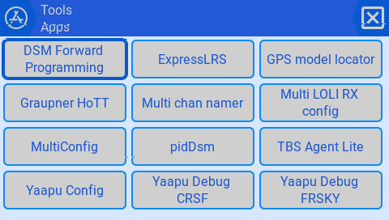
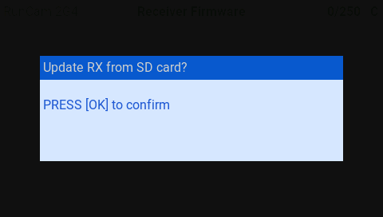
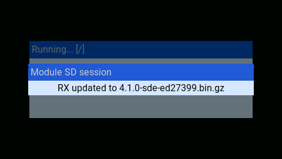
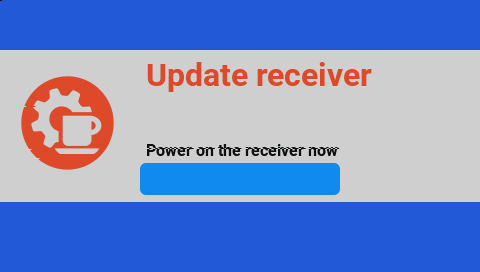

!!! warning "Not released yet"
    This feature is in test builds only. It needs a special build of **EdgeTX**, a special build of **ExpressLRS** on the TX module, and the same build on the receiver. None of it is in a release.

    * EdgeTX: [MUSTARDTIGERFPV/edgetx, branch `elrs-oh-tee-eh`](https://github.com/MUSTARDTIGERFPV/edgetx/tree/elrs-oh-tee-eh)
    * ExpressLRS: [mustardtigerfpv/expresslrs, branch `elrs-oh-tee-eh`](https://github.com/mustardtigerfpv/expresslrs/tree/elrs-oh-tee-eh)

    Menu names, file names and messages on this page can still change before a release.

Your radio's SD card can hold receiver firmware, and your TX module can send it to a bound receiver over the air. You don't need a cable, a flight controller passthrough or the receiver's WiFi hotspot. The receiver keeps its binding, settings and hardware layout.

There are two actions, both in the ExpressLRS Lua script under `Receiver Firmware`:

* `Sync from WiFi` makes the TX module join your home WiFi and download receiver firmware that matches the TX module's firmware. It saves the files to the radio's SD card. The receiver is not changed. The menu shows the network name, for example `Sync from WiFi (HomeNet)`.
* `Update Receiver` sends the matching firmware from the SD card to the receiver. It takes about 10 to 15 seconds. A connected receiver is updated right away. A receiver that isn't connected is updated when you power it on (see [Updating a receiver that won't connect](#updating-a-receiver-that-wont-connect)).

You can skip `Sync from WiFi` and copy the firmware onto the card yourself. See [Getting the images](#getting-the-images).

`Bind`, at the top of the Lua script, uses this too: a new receiver gets bound, and offered the update if it needs one. See [Binding a new receiver](#binding-a-new-receiver).

## What you need

* **The current `elrs.lua` script** from the ExpressLRS repository, in `/SCRIPTS/TOOLS/` on the radio. Delete old copies such as `ELRS.lua`, `elrsV2.lua` and `elrsV3.lua`. See [the Lua script guide](../quick-start/transmitters/lua-howto.md#installing-the-lua-script).
* **An EdgeTX radio** running the build linked above. The feature was developed on a RadioMaster TX16S MK1 (480x272 color screen). Radios with other screens show a simpler popup, which has not been tested.
* **A TX module** with an ESP32-family chip (ESP32, ESP32-S3 or ESP32-C3) running the ExpressLRS build linked above. It was developed on an ESP32-S3 module. ESP8285 and STM32 TX modules don't have this feature.
* **A receiver** with an ESP32-family chip or an ESP8285, running the same ExpressLRS build. STM32 receivers are not supported.
* **The receiver bound to the TX module**, with the same binding phrase or with `Bind`.
* **The receiver** either connected to your TX module (the `C` on the Lua script's title bar), or close enough that you can power it on during the update. Either way, the aircraft must be **disarmed**.
* **An SD card** in the radio. While the radio is in USB storage mode, the card is not available to the TX module.
* **Your home WiFi set on the TX module**, for `Sync from WiFi`. Use the same `WiFi SSID` and `WiFi password` you set in the ExpressLRS Configurator or on the module's web page. The network must be 2.4 GHz.

!!! note "The first install is the old way"
    The receiver has to already run firmware that includes this feature. Flash it once with the Configurator, WiFi or passthrough as usual. After that, updates can come from the SD card.

## Prepare the SD card

Everything lives in an `ELRS` folder at the top level of the card. The update feature only uses this folder, so your models and settings are not touched.

```
/ELRS/
    FIRMWARE/
        esp32-2400/
            4.1.0.bin.gz
        esp8285-2400/
            4.1.0.bin.gz
```

You don't need to create these folders by hand. The radio creates `/ELRS/` the first time a session starts, and `Sync from WiFi` fills `FIRMWARE/`.

## Getting the images

### Option 1: Sync from WiFi

This is the normal way. The TX module joins your home WiFi and downloads the receiver images that match its own firmware version. Whatever version your TX module runs, the receivers get the matching image. Images already on the card are skipped.

To update everything, do two steps: update the TX module the way you always do, then run `Sync from WiFi`. After that, update each receiver whenever it suits you.

Sync never deletes old versions. Read [Which image goes to which receiver](#which-image-goes-to-which-receiver) before you let several versions pile up on the card.

!!! note "Builds you made yourself"
    Images are only published for official ExpressLRS builds. A TX module running firmware you compiled yourself finds nothing and shows `No RX images published for this TX build`. Flash an official build to sync.

### For developers

For development and testing only: you can point `Sync from WiFi` at a different image source by putting a file called `WIFI.TXT` in `/ELRS/`. Its first line is the `http://` address of the image list, for example:

```
http://192.168.1.50:8088/manifest.json
```

The TX module still joins your home network. Delete the file to go back to the published images.

### Option 2: copy the images yourself

Put the radio in USB storage mode, or take the card out and use a card reader. Copy the files into `/ELRS/FIRMWARE/<key>/`, where `<key>` is the image key for your receiver (see the table below).

* **ESP8285 receivers** need a `.bin.gz` file.
* **ESP32-family receivers** accept a `.bin` or a `.bin.gz` file.

The file can have any name, as long as it ends in `.bin` or `.bin.gz` and the folder name is the exact image key. Eject the card safely and put the radio back in normal mode before you run an update.

### Which image goes to which receiver

When you run `Update Receiver`, the TX module finds out which kind of receiver it is talking to and uses the image for that image key. It uses the image that the last `Sync from WiFi` saved for that key. If you copied images by hand and never synced, it uses **the last file in alphabetical order** in `/ELRS/FIRMWARE/<key>/`. That sort is by text, not by version number, so `4.9.0` sorts after `4.10.0`. Keep one image per folder.

Receivers set up for the EU (LBT) on 2.4 GHz use the same images as everyone else. LBT is part of the receiver's own settings, and an update keeps it.

| Receiver | Image key |
| --- | --- |
| ESP32 2.4 GHz | `esp32-2400` |
| ESP32-S3 2.4 GHz | `esp32s3-2400` |
| ESP32-C3 2.4 GHz | `esp32c3-2400` |
| ESP32 900 MHz | `esp32-900` |
| ESP32-S3 900 MHz | `esp32s3-900` |
| ESP32-C3 900 MHz | `esp32c3-900` |
| ESP32 / S3 / C3 with an LR1121 | `esp32-lr1121`, `esp32s3-lr1121`, `esp32c3-lr1121` |
| ESP32 / S3 / C3 with an LR2021 | `esp32-lr2021`, `esp32s3-lr2021`, `esp32c3-lr2021` |
| ESP8285 2.4 GHz | `esp8285-2400` |
| ESP8285 900 MHz | `esp8285-900` |

If you aren't sure, run `Update Receiver` with no image on the card. The error names the key, for example `No esp8285-2400 image on SD - sync first`.

## Run an update

Before you start, check these:

* The receiver is powered and the radio shows the link as connected. If it won't connect, see [Updating a receiver that won't connect](#updating-a-receiver-that-wont-connect).
* The aircraft is disarmed and the props are off. Both the radio and the receiver refuse to start an update while armed.
* The right image is on the card.

Steps:

1. Press ++"SYS"++, open `Tools`, then `Apps`, and run the `ExpressLRS` Lua script.

    <figure markdown>
    
    </figure>

2. Scroll to `Receiver Firmware` and press ++enter++.

    <figure markdown>
    
    </figure>

3. The folder's title bar reads `Receiver Firmware`. Select `Update Receiver` and press ++enter++.

    <figure markdown>
    
    </figure>

4. The script asks `Update RX from SD card?`. Press ++enter++ to confirm, or ++exit++ to back out.

    <figure markdown>
    
    </figure>

5. The radio takes over the screen and shows what the TX module is doing: `Finding receiver`, `Erasing on RX`, `Sending` with a size count and a progress bar, then `Verifying on RX`.

    <figure markdown>
    
    </figure>

    <figure markdown>
    
    </figure>

6. A message box shows the result. Press ++enter++ to close it.

Don't power anything off while the progress bar moves. The link to the model is lost for the whole update, so the aircraft won't respond to your sticks. Press ++exit++ on the radio to cancel.

### What success looks like

The result box says `RX updated to <file name>`, where the file name is the image that was sent. The radio beeps.

<figure markdown>

</figure>

The receiver reboots into the new firmware. An ESP8285 receiver can take a little longer to come back. When the link returns, the receiver is still bound to your TX module and keeps its settings. To check the version, see [Checking the receiver firmware version](../quick-start/receivers/firmware-version.md).

### If an update is interrupted

If the update fails or the link drops before the receiver has confirmed the new image, the receiver stays on its old firmware. If the TX module can no longer reach it, the receiver restarts on its own. Find the cause in the [troubleshooting](#troubleshooting) messages, then run `Update Receiver` again.

### Updating a receiver that won't connect

When a receiver with this feature powers on, it listens for its TX module for a short time. That's how you reach a receiver that can't connect: one on a different major version than your TX module, one with settings that don't match, or one that is simply off.

1. Make sure the receiver is **powered off**.
2. Run `Update Receiver` as above. With no receiver connected, the radio shows `Power on the receiver now`.

    <figure markdown>
    
    </figure>

3. Power the receiver on within 30 seconds, close to the radio. The update starts on its own and runs as usual.

A receiver in bind mode answers too, bound or not. The radio shows `Found <name>` for 3 seconds, so you can press ++exit++ if it's the wrong one, then updates it and binds it to your TX module.

If nothing answers in time, the radio shows `Receiver not found at power-on`. Check that the receiver is bound to this TX module, or in bind mode, and runs firmware with this feature, then try again.

!!! tip "Changing major versions"
    Receivers on an older major version can't connect to a TX module on a newer one. That's fine: update the TX module, run `Sync from WiFi`, then update each receiver with the power-on method above whenever you get to it.

### Binding a new receiver

`Bind` in the Lua script first looks for a receiver in bind mode that has this feature, for about a second. If one answers, it's bound straight away. Receivers without this feature bind the usual way.

If the receiver runs different firmware than your TX module, the script asks `Update <name> to <version>?`.

* Press ++enter++ to update it now. The update runs as usual.
* Press ++exit++ to keep the firmware it has. It stays bound. A receiver on another major version can't connect until it's updated, and the script says so.

That makes setting up a new receiver one step: power it on in bind mode, then press `Bind`. If several receivers are in bind mode nearby, the first one to answer is bound, and its name is in the question.

## Run a sync

1. Open the Lua script and go to `Receiver Firmware`.
2. Select `Sync from WiFi` and press ++enter++. The name in brackets is the home network set on the TX module. There is no confirmation, because sync only writes to the SD card.

    <figure markdown>
    
    </figure>

3. The radio shows `Joining <network>`, `Fetching manifest`, then one line per image with a size count.

    <figure markdown>
    
    </figure>

4. The result reads `Synced <n>, <n> current, <n> failed`. `current` counts images that were already on the card. Check anything under `failed` in [Troubleshooting](#troubleshooting).

    <figure markdown>
    
    </figure>

The TX module disconnects from your home WiFi when it's done. The link to your model is down while the sync runs, as it is during an update.

## Troubleshooting

The message appears either in a box on the radio, or in the Lua script's `Receiver Firmware` folder for a few seconds after the radio's screen closes.

### The session never starts

| Message | Meaning and fix |
| --- | --- |
| `Busy` | A session is already running. Wait for it to end. |
| `No answer - needs EdgeTX with SD support` | The radio didn't respond in time. It is probably not running an EdgeTX build with this feature. See [What you need](#what-you-need). |
| `Radio: armed` | The radio's arming switch for this module is on. Disarm. |
| `Radio: USB storage is on` | The radio is connected to a computer as a USB drive. Unplug it or eject the drive. |
| `Radio: no SD card` | Put an SD card in the radio. |
| `Module refused: Armed` | The TX module sees the aircraft as armed (channel 5 high). Disarm. |
| `Module refused: RX firmware too old?` or `Receiver didn't respond - firmware too old?` | The receiver is connected but ignored the update command. It most likely runs firmware from before this feature. Flash it the old way once. A very weak link can cause the same message, so move closer and try again first. |
| `No answer from module`, `Module stopped answering`, `Module not ready`, `Module port busy` | The radio lost the TX module. Check that the module is powered and that the CRSF settings in the model are right (see [Radio Preparation](../quick-start/transmitters/tx-prep.md)). Power cycle the module and try again. |
| `Radio didn't answer` | The TX module couldn't reach the radio's SD card. Power cycle both and try again. |

### Update Receiver fails

| Message | Meaning and fix |
| --- | --- |
| `Receiver not found` | The receiver got the update command but didn't answer during the update. It is usually too far from the TX module. Move it closer and try again. |
| `Receiver not found at power-on` | Nothing answered after `Power on the receiver now`. Check that the receiver was powered on in time, is bound to this TX module or in bind mode, and runs firmware with this feature. |
| `No <key> image on SD - sync first` | There is no `.bin` or `.bin.gz` file in `/ELRS/FIRMWARE/<key>/`. ESP8285 receivers only accept `.bin.gz`. Get the image with `Sync from WiFi`, or copy it onto the card. |
| `Can't read image from SD` | The file can't be read, or it isn't a valid gzip file. Copy it to the card again. |
| `Image too big for RX` | The image doesn't fit the receiver. Check that it's the right image for that receiver. ESP8285 receivers accept a gzip file of up to about 430 KB. |
| `RX refused the image` | The receiver couldn't prepare for the image, either because it's too big or because it has no room for it. Make sure you have the right image key. |
| `Transfer failed` | The transfer broke off, usually because the link dropped. Put the receiver closer to the TX module and try again. If it keeps happening, check the SD card. |
| `RX did not confirm` | The receiver didn't confirm the finished image in time. It might still have taken it. Wait a minute, then check the receiver's version. |
| `RX: hash mismatch` | The image arrived damaged. Try again. If it repeats, the file on the card is bad: copy it again or sync again. |
| `RX: short image`, `RX: verify failed`, `RX: update failed`, `RX: config carry failed`, `RX: trailer copy failed` | The receiver found a problem while finishing, and it stays on the old firmware. Try again. If it repeats, sync again or copy the image for that receiver onto the card again. |
| `ESP-NOW init failed` | The TX module couldn't start its wireless link. Power cycle it. |
| `Cancelled` | You pressed ++exit++. |

### Sync from WiFi fails

| Message | Meaning and fix |
| --- | --- |
| `No home WiFi set on the TX module` | Set `WiFi SSID` and `WiFi password` for the TX module in the Configurator or on its web page. See [What you need](#what-you-need). |
| `could not join <network>` | The TX module couldn't join the network in time. Check the WiFi name and password set on the TX module, and that the network is 2.4 GHz and in range. |
| `No RX images published for this TX build` | The TX module runs firmware that ExpressLRS didn't publish images for. Flash an official build. See [Builds you made yourself](#option-1-sync-from-wifi). |
| `manifest GET <code>` | The image server answered with that HTTP code. A negative number means it couldn't be reached at all. Check that your home network has internet access, then try again. |
| `bad manifest` | The list of images the TX module downloaded isn't valid. Try again later. |
| `Synced ..., <n> failed` | Some images didn't arrive. The images that did arrive stay on the card. Run `Sync from WiFi` again. If it keeps failing, check that your home network has internet access. |

## Limits

* The receiver must already run firmware with this feature. The first install is done another way. After that, it can be updated even when it can't connect, by powering it on during the update.
* A receiver bound to a different TX module can't be reached, unless you put it in bind mode first.
* The aircraft must be disarmed. A running update means no link and no control.
* Only ESP32-family and ESP8285 receivers, and only ESP32-family TX modules.
* `Sync from WiFi` uses the TX module's home network, which must be 2.4 GHz. It downloads over an unencrypted `http://` connection.
* Receiver images are published for official ExpressLRS builds only.
* Only tested on a RadioMaster TX16S MK1.
